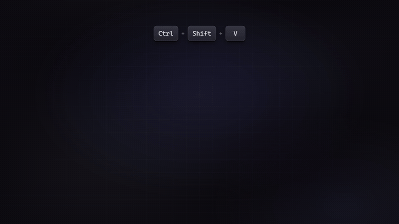

<div align="center">


# betterPaste

**A clipboard history manager for Windows — a drop-in replacement for `Win+V`.**

Offline · Fast · Keyboard-first · Image support · Pinned slots

</div>

---


<p align="center"><em>The overlay: search on the left, live preview on the right, pinned slots numbered.</em></p>

<!-- 动图占位：发布前补上 docs/demo.gif -->
<!--  -->

## Why

Windows' built-in clipboard history (`Win+V`) is fine until you need to **search it
in Chinese**, keep **images** around, or paste code with **byte-exact indentation**.
`betterPaste` does all three, stays completely offline, and never takes your focus away
from the window you were typing in.

## Install

Grab `betterPaste_0.1.0_x64-setup.exe` from the [latest release](../../releases/latest)
and run it. The installer is per-user, so no admin prompt.

> **Windows SmartScreen**: the binary is not code-signed, so the first run may show
> *"Windows protected your PC"*. Click **More info → Run anyway**.
> You can verify what you downloaded against the SHA-256 published in the release notes.

## Usage

| Action | Shortcut |
| --- | --- |
| Open history overlay | `Ctrl+Shift+V` (rebindable) |
| Select | `↑` / `↓` / `PgUp` / `PgDn` |
| Paste into the window you came from | `Enter` |
| Copy without pasting | `Shift+Enter` |
| Paste a pinned slot directly | `Ctrl+Shift+1` … `Ctrl+Shift+9` |
| Pin / unpin the selection | `Ctrl+P` |
| Delete one entry | `Ctrl+Del` |
| Close | `Esc` |

Everything is also clickable; double-clicking a row pastes it.

Right-click the tray icon for **打开剪贴板历史 / 暂停记录 / 设置… / 退出 betterPaste**.

### Settings

The settings window (tray → *设置…*) covers:

* history limits — **entry count / retention days / per-item size**
* what gets captured — text, images
* the overlay hotkey and all nine slot hotkeys (click the field, press the combo)
* theme — follow system / light / dark
* paste behaviour, hide-on-blur, launch at login
* the data directory, plus *clear unpinned* / *clear all*

## Where your data lives

```
%APPDATA%\betterPaste\
├── betterpaste.db      SQLite (entries + FTS5 full-text index)
├── images\           full-size clipboard images (PNG)
├── thumbs\           generated thumbnails
└── config.json       your settings
```

Nothing is encrypted and nothing leaves the machine — there is **no network code in
this app at all**. If you want it gone, delete that folder.

## What it does *not* do (by design)

Rich text / HTML, file-and-folder history, templating, encryption, cloud sync, code
signing, macOS / Linux. See [`docs/验收报告.md`](docs/验收报告.md) for the measured
results against every acceptance criterion, and `架构与验收标准.md` for the decision log.

Known limitation worth stating up front: the clipboard is watched by **polling the
Windows clipboard sequence number every 60 ms**. Human-speed copying is captured
100 % (100/100 in testing), but a script that copies dozens of times per second will
outrun the sampler. Fixing that properly means switching to
`AddClipboardFormatListener` with a message-only window — planned, not in v0.1.

## Built with

**Tauri 2 + Rust** for the system layer and **TypeScript + Svelte 5 + Vite** for the
UI. Storage is SQLite via `rusqlite` (FTS5 for search, `LIKE` as a Chinese-friendly
fallback), the clipboard is read with `arboard` and written through the Win32
`CF_UNICODETEXT` / DIB formats, and the paste path uses `GetForegroundWindow` +
`SendInput` so the keystroke always lands in the window you started from.

### Hacking on it

```powershell
npm install
npm run app:dev      # tauri dev — hot-reloading overlay + settings
npm run app:build    # tauri build — produces the NSIS installer
cargo test --lib --manifest-path src-tauri/Cargo.toml   # 25 unit tests
```

Because this machine has no MSVC, the toolchain is
`stable-x86_64-pc-windows-gnu` with MinGW-w64. Every cargo invocation needs the
custom rustup/cargo homes:

```powershell
# every cargo invocation needs the custom rustup/cargo homes
$env:CARGO_HOME='D:\Software\Rust\cargo'; $env:RUSTUP_HOME='D:\Software\Rust\rustup'
```

These are **build-time only** dependencies. The shipped `*_setup.exe` bundles the
already-compiled `betterPaste.exe` plus the WebView2 loader, so an end user needs
nothing but Windows (WebView2 is preinstalled on Windows 11 and shipped by the
installer otherwise) — no Rust, no GCC, no Node.

Two build constraints worth knowing:

1. **Keep the checkout on a pure ASCII path** (this project lives at
   `D:\Dsh_Work\projects\betterPaste`). MinGW's `windres` / `dlltool` cannot open
   files under a path with non-ASCII characters and the link fails with
   `can't open icon file ... Invalid argument`. That is why the repo was moved off
   its original Chinese path; no `target-dir` redirect is needed any more, the
   default `target/` is used (verified with a clean `cargo check`, 2026-10-09).
2. `Cargo.toml` uses `crate-type = ["rlib"]` only — adding `cdylib` makes GNU ld try
   to export every public symbol and fail with `export ordinal too large`.

### Debug / ops entry points

The single binary is also a small diagnostic tool (see the acceptance report for the
full list):

```powershell
betterPaste.exe --probe "keyword" --bench 30   # search + latency benchmark
betterPaste.exe --ctl pin 3 "some text"        # pin a row to a slot
betterPaste.exe --overlay                      # show the overlay right away
betterPaste.exe --settings                     # show the settings window
```

`scripts/gen-icon.mjs` regenerates the source app icon with zero dependencies.

## License

[MIT](LICENSE)
