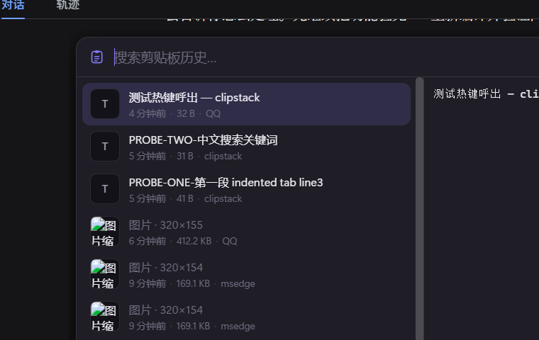
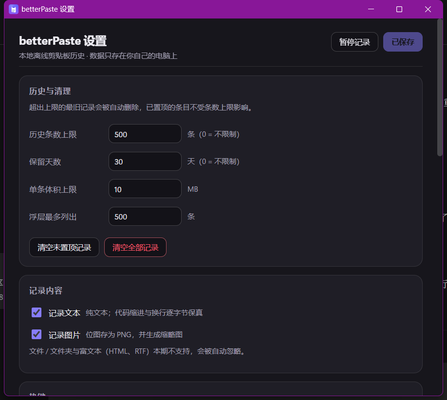

<div align="center">


# betterPaste

**Windows 剪贴板历史工具 —— 全面替代 `Win+V`。**

完全离线 · 快 · 键盘优先 · 支持图片 · 置顶槽位

</div>

---



<p align="center"><em>浮层：左边搜索与列表，右边实时预览，置顶槽位带编号。</em></p>

## 为什么做它

Windows 自带的剪贴板历史（`Win+V`）能用，但一旦你需要**用中文搜索**、留住**图片**、
或者粘贴带**逐字节缩进**的代码，它就力不从心了。betterPaste 把这三件事都做了，
全程离线，而且从不把你正在打字的那个窗口弄丢焦点。

## 安装

到 [最新发布](../../releases/latest) 下载 `betterPaste_0.2.2_x64-setup.exe` 直接运行。
安装是「当前用户」模式，**不会弹 UAC**，卸载走系统的「应用和功能」即可。

> **SmartScreen 提示**：程序没有做代码签名，首次运行会看到
> 「Windows 已保护你的电脑」，点 **更多信息 → 仍要运行** 就行。
> 发布说明里会给出安装包的 SHA-256，方便你核对下载是否完整。

## 用法

| 操作 | 快捷键 |
| --- | --- |
| 打开历史浮层 | `Ctrl+Shift+V`（可改） |
| 上下选择 | `↑` `↓` `PgUp` `PgDn` |
| 粘贴到原来的窗口 | `Enter` |
| 只复制不粘贴 | `Shift+Enter` |
| 直接粘贴某个置顶槽位 | `Ctrl+Shift+1` … `Ctrl+Shift+9` |
| 置顶 / 取消置顶 | `F2`（或行尾 📌 按钮选槽位） |
| 删除当前条目 | `Del` |
| 勾选多条（`Space` 勾、`Ctrl+点击` 也行） | `Del` 批量删除 |
| 关闭 | `Esc` |

界面上的东西都能点，**双击某一行就是粘贴**。

右键托盘图标有：**打开剪贴板历史 / 暂停记录剪贴板 / 设置… / 退出 betterPaste**。
「暂停记录」是个勾选项，暂停期间复制的东西不会进历史（托盘提示里会写当前状态）。

### 设置

托盘 →「设置…」（或浮层左上角 ⚙）可以调：

* **历史与清理** —— 条数上限 / 保留天数 / 单条体积上限，以及「清空未置顶记录」「清空全部记录」
* **记录内容** —— 文本、图片各自是否记录
* **热键** —— 浮层热键 + 九个槽位热键（点输入框再按组合键即可录入）
* **外观** —— 跟随系统 / 浅色 / 深色
* **粘贴行为** —— 是否自动粘贴、失焦是否收起、开机自启
* **数据目录** —— 打开目录、迁移到别处、恢复默认位置



## 数据放在哪

```
%APPDATA%\betterPaste\
├── betterpaste.db      SQLite（条目 + FTS5 全文索引）
├── images\           剪贴板图片原图（PNG）
├── thumbs\           缩略图
└── config.json       你的设置
```

数据**不加密、也永远不出这台电脑** —— 这个程序里压根没有网络代码。
想彻底清干净，删掉这个目录即可。

## 它不做什么（有意为之）

富文本 / HTML、文件和文件夹历史、模板粘贴、加密、云同步、代码签名、macOS / Linux。

一个值得先说明的已知限制：剪贴板是靠**每 60 ms 轮询 Windows 剪贴板序号**来监听的。
人手速度的复制 100% 抓得到（实测 100/100），但脚本每秒复制几十次会跑赢采样器。
彻底解决要换成带消息窗口的 `AddClipboardFormatListener` —— 计划中，不在 v0.2。

## 技术栈

系统层 **Tauri 2 + Rust**，界面 **TypeScript + Svelte 5 + Vite**。
存储用 `rusqlite`（搜索走 FTS5，再用 `LIKE` 子串兜底，所以中文照样搜得到），
剪贴板读写走 `arboard` 与 Win32 的 `CF_UNICODETEXT` / DIB 格式，
粘贴路径用 `GetForegroundWindow` + `SendInput`，保证按键落在你出发时的那个窗口。

### 本地构建

```powershell
npm install
npm run app:dev      # tauri dev：浮层与设置面板都能热重载
npm run app:build    # tauri build：产出 NSIS 安装包
cargo test --lib --manifest-path src-tauri/Cargo.toml   # 35 个单元测试
```

工具链是 `stable-x86_64-pc-windows-gnu` + MinGW-w64（不需要 MSVC）。
若你把 Rust/GCC 装在自定义位置，构建前要先指好环境变量：

```powershell
$env:CARGO_HOME='<你的 cargo 目录>'; $env:RUSTUP_HOME='<你的 rustup 目录>'
```

这些只是**编译期**依赖：发布出去的 `*_setup.exe` 里已经打包好编译完成的
`betterPaste.exe` 与 WebView2 Loader，终端用户只要有 Windows 就行 ——
不需要 Rust、不需要 GCC、也不需要 Node。

两条构建约束值得知道：

1. **仓库路径保持纯 ASCII**。MinGW 的 `windres` / `dlltool` 打不开含非 ASCII 字符的路径，
   链接会以 `can't open icon file ... Invalid argument` 失败。
2. `Cargo.toml` 的 `crate-type` 只用 `["rlib"]` —— 加上 `cdylib` 会让 GNU ld 试图导出全部符号，
   以 `export ordinal too large` 失败。

### 运维 / 诊断入口

同一个 exe 也是个小的诊断工具（完整清单见验收报告）：

```powershell
betterPaste.exe --probe "关键词" --bench 30   # 搜索 + 延迟基准
betterPaste.exe --ctl pin 3 "某段文本"          # 把某条记录钉到槽位
betterPaste.exe --overlay                      # 立刻亮出浮层
betterPaste.exe --settings                     # 打开设置面板
betterPaste.exe --data-dir                     # 看当前数据目录
betterPaste.exe --migrate-data <目录>           # 迁移数据（复制，不删原目录）
betterPaste.exe --reset-data-dir               # 恢复默认数据目录
```

`scripts/gen-icon.mjs` 零依赖重生成应用图标（`npx tauri icon assets/icon.png` 再展开成整套尺寸）。

实测结论、每个验收项的实测数字与踩坑记录都在
[`docs/验收报告.md`](docs/验收报告.md) 与 [`docs/BUG报告-v0.1.0.md`](docs/BUG报告-v0.1.0.md)。

## 许可证

[MIT](LICENSE)

---

<sub>English: betterPaste is an offline clipboard-history manager for Windows
(Tauri 2 + Rust + Svelte) — searchable Chinese text, images, byte-exact code
paste, and nine pinned slots. No network code, no telemetry, no signing.</sub>
